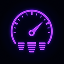

# MILLENIUM HUD

**Hello from Spotik.** · Полупрозрачный HUD для **Assetto Corsa** (CSP):
спидометр с оборотами, педали с процентами, передача отдельной плашкой, температура шин.
Отдельный проект семейства **Mellenium** — та же тёмная стилистика
и фиолетовый акцент. Работает независимо от основного Mellenium.



## Виджеты

| Виджет | Что показывает |
|---|---|
| **Спидометр** | Скорость (км/ч, огромными жирными цифрами на всю плашку) и обороты с красной зоной. **Два режима**: цифровой блок с полосой RPM или **дуговой прибор** со стрелкой и засечками каждые 1000 об/мин. Лимитер читается из `engine.ini` установленной модели — красная зона всегда по делу. Опциональная **вспышка** при приближении к лимитеру (порог настраивается). |
| **Педали** | Шкалы **GAS / BRK / CLT / HB** с процентами, цвета как в Mellenium. Яркость шкалы растёт с нажатием. CLT показывает **нажатие** (кик сцепления — всплеск шкалы). |
| **Передача** | Текущая передача отдельной плашкой (между педалями и шинами): **огромная жирная цифра** на всю плашку (DWrite-рендер с произвольным кеглем, на старых CSP — откат на крупный встроенный шрифт). N тусклая, скоростные — фирменным фиолетовым, у красной зоны — мигает красным. |
| **Шины** | Температура резины по каждому колесу (LF/RF — перед, LR/RR — зад), состояние цветом: **серая** — обычное (<75°), **зелёная** — отличное (75–100°), **жёлтая** — хуже (100–115°), **красная** — совсем горячие (115°+). Подложка виджета отключается вместе с общим фоном. |

## Настройки

Окно настроек открывается иконкой на панели приложений AC. Всё в духе Mellenium:

- включение каждого виджета отдельно (спидометр, педали, передача, шины);
- режим спидометра (цифра/дуга) и порог вспышки переключения;
- **отключаемый фон виджетов** (выкл — чистые цифры поверх игры, без подложки);
- прозрачность подложек (15–95 %) и общий масштаб (80–140 %) — вёрстка текста
  строится по реальной высоте строк, поэтому цифры не налезают ни при каком масштабе;
- **перетаскивание панели мышью** (за любое место полоски) + сдвиги X/Y
  слайдерами и кнопка «Вернуть в центр».

Панель собирается в одну линию внизу по центру экрана; выключенный виджет
не занимает место — оставшийся сдвигается.

## Установка

1. Распакуйте `MilleniumHUD.zip` в корень игры (папка попадёт в
   `assettocorsa\apps\lua\MilleniumHUD\`) или просто перетащите zip в Content Manager.
2. Включите приложение **Millenium HUD** в списке приложений (Content Manager
   или боковая панель в игре).
3. Настройки — по иконке на панели справа.

## Технические заметки

- Отрисовка: `[UI_CALLBACKS] IN_GAME` + `ui.transparentWindow` (окно без фона,
  подложки и примитивы рисуются вручную: `drawRectFilled/drawCircleFilled/
  drawLine`, дуга прибора — сегментированными линиями; `LAZY = NONE`, HUD живёт
  даже без открытого окна настроек).
- Передача: семантика `ac.StateCar.gear` — `-1 = R`, `0 = N`, `1..n` (подтверждено
  по коду приложений CSP).
- Перетаскивание: по `ui.mousePos()` и `ui.rectHovered()` в локальных
  координатах окна; когда выключено — оверлей не перехватывает клики.
- Текст центрируется через `ui.drawTextClipped` с молчаливым откатом на
  старых сборках CSP. Шрифты CSP фиксированы и не масштабируются — цифровой
  спидометр верстается по замеренной высоте строк (`ui.measureText`), а при
  масштабе <95 % крупные цифры сбрасываются на спокойный кегль Title.

## Файлы

```
MilleniumHUD/
├── manifest.ini      — описание приложения для CSP
├── MilleniumHUD.lua  — вся логика HUD и настроек
├── icon.png          — иконка на панели задач
└── README.md         — этот файл
```

Версия 1.4.3 · Millenium HUD

**Changelog**
- 1.4.3 — фирменная подпись обновлена на **«Hello from Spotik»**: заголовок скрипта, строка в настройках, манифест и документация. Функционально без изменений.
- 1.4.2 — «км/ч» больше не прячется за шкалу: подпись жёстко пришита между цифрой скорости и полосой RPM (фиксированная позиция над шкалой), а цифра подгоняется в оставшееся место выше неё.
- 1.4.1 — **скорость крупная, как передача**: цифровой спидометр переведён на DWrite-рендер — кегль подгоняется под свободную высоту плашки (≈92 % доступного места над полосой RPM, жирный вес 800), с автоматической поджимкой по ширине длинных значений (199+ км/ч); пустое место в блоке убрано, «км/ч» аккуратно снизу. На старых CSP — откат на прежний стек встроенных кеглей.
- 1.4.0 — **передача стала по-настоящему крупной**: плашка переведена на DWrite-рендер (`ui.pushDWriteFont`/`ui.dwriteDrawText` — тот же API, что у встроенных приложений CSP) с пиксельным кеглем ≈58 % высоты плашки и максимально жирным начертанием (Segoe UI 800); на старых сборках CSP без DWrite-текста — тихий откат на встроенный Huge. **Бренд-блок в левом верхнем углу**: «millenium HUD» + версия, строкой ниже полупрозрачно «Made by Spot1k for assetto corsa»; без фона, с лёгкой тенью под буквами, виден даже при выключенных виджетах; выключается тумблером в «Внешнем виде».
- 1.3.0 — **передача — отдельная плашка**: выведена из спидометра (из обоих режимов — цифрового и дугового) в собственный виджет между педалями и шинами; N тусклая, остальные — фиолетовые, у красной зоны плашка мигает красным (порог общий со спидометром); кегль цифры тот же, что у спидометра (компактный при масштабе <95 %). Тумблер в настройках. Цифровой спидометр стал чище: стек теперь только «скорость → км/ч», отцентрован по высоте панели.
- 1.2.0 — **виджет температуры шин** (отключаемый): по каждому колесу температура ядра резины из `car.wheels` с индикацией состояния цветом — серая «обычное» (<75°), зелёная «отличное» (75–100°), жёлтая «хуже» (100–115°), красная «совсем горячие» (115°+); на старых CSP без поля температуры показывает аккуратный «—». **Инвертировано сцепление**: шкала CLT раньше читала `car.clutch` напрямую и в покое стояла на 100 % — теперь, как в Mellenium, показывает нажатие педали (idle = 0 %, кик сцепления = всплеск к 100 %). Сборка панели переведена на список виджетов: включённые идут подряд без дыр.
- 1.1.0 — **ребрендинг: Millenium HUD** (папка, манифест, заголовки, ID окна);
  семейство теперь Mellenium. **Радар удалён** (по решению автора). **Фон
  виджетов отключается**: тумблер в «Внешнем виде» — остаются чистые цифры
  поверх игры. **Починено налезание цифр при масштабировании**: в цифровом
  спидометре блоки «передача → скорость → км/ч» раньше позиционировались
  процентами от высоты панели, а шрифты не масштабируются — при уменьшении
  панели цифры залезали друг на друга; теперь вёрстка считается по реальной
  высоте строк через `ui.measureText`, а при масштабе <95 % огромный кегль
  цифр сбрасывается на Title.
- 1.0.0 — первый релиз (как Blackhelm HUD): полупрозрачная панель из трёх
  виджетов. Спидометр в двух режимах (цифровой блок / дуговой прибор со
  стрелкой, красная зона и засечки по лимитеру из `engine.ini`), вспышка
  переключения с настраиваемым порогом; педали GAS/BRK/CLT/HB с процентами;
  радар машин с кольцами дистанции и предупреждением о близости (<8 м).
  Масштаб, прозрачность, позиция (мышь или слайдеры) — в настройках.
